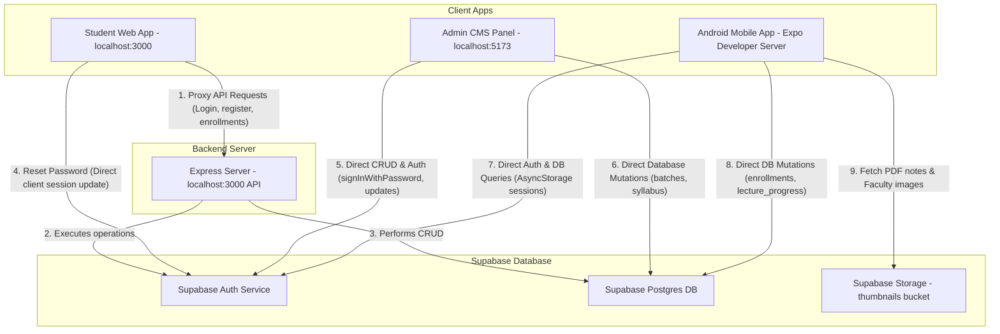

> HISTORICAL SNAPSHOT — captured 2026-11-09 from memory.md. Not current instructions or deployment status. Later entries may supersede earlier entries. Credentials redacted; obsolete local hyperlinks converted to labels. See [current state](../CURRENT-STATE.md).

# C50 Academy — Project Memory & Knowledge Base

## Carrier50 Android launcher branding — 2026-11-09

- Display name is Carrier50 in both Expo configuration sources and both distribution modes; package IDs, signing credentials and payment separation preserved.
- Supplied unnamed.png preserved as assets/carrier50-logo.png. Exported black-backed standard/adaptive launcher assets with mask-safe padding; removed placeholder adaptive background/monochrome references. Export script: c50-mobile/scripts/export-launcher-icons.cjs. Splash/store artwork unchanged.
- Regenerated ignored local Android resources; verified Carrier50 label and adaptive XML. TypeScript and all 29 mobile tests pass. Both resolved distribution configurations checked.
- Configured the two existing public Supabase values in EAS preview environment (no server secrets). Preview APK build submitted: 6130b55f-2803-4657-b12c-7edbf8224724. Build FINISHED; downloaded dist/branding/Carrier50-preview.apk and inspected packaged Carrier50 label, direct package ID, black adaptive background, absence of placeholder monochrome layer, and extracted supplied-logo foreground. No connected-device runtime test or Play submission.

## Terms of Service — 2026-11-05

- Added C50-Project/public/terms/index.html for Carrier50 / C50 Academy, legal owner Sunil Rajput, support carrierdds50@gmail.com. User confirmed no refunds or cancellations; page preserves mandatory legal remedies and payment-dispute rights.
- Added public Express /terms and /terms/ routes before authentication/CORS middleware, replaced homepage footer placeholder with a real link, and linked from privacy/deletion pages. Covers accounts, verified paid enrollment, content rights, availability, privacy and deletion. No mobile binary or checkout changes.
- Production build passed (existing bundle-size warning); local production HTTP checks passed for both routes, correct policy/owner and script-free HTML. No visual browser check or live deployment performed.
- Remaining: owner/legal review, push/deploy web changes to Render, verify live https://c50-web.onrender.com/terms, then submit that URL in Play Console. No claim of complete legal compliance.

## Google Play listing artwork — 2026-11-01

- Generated matching silver/gold Carrier50 icon and feature graphic using the existing website logo as reference. Final opaque RGB PNGs saved in store-assets/: carrier50-play-icon-512.png (512x512, 295381 bytes) and carrier50-feature-1024x500.png (1024x500, 978170 bytes). Dimensions, sizes and final images checked. Generation prompts and export script included. No app icon replacement, binary build or store upload performed.

## Account deletion request page — 2026-11-01

- Added public, script-free `/delete-account` and `/delete-account/` pages with C50 Academy/Carrier-50 identity, owner Sunil Rajput, support email carrierdds50@gmail.com, prefilled email request plus copyable fallback, ownership-verification steps, data categories, loss-of-access warning and retention disclosures. No login required.
- User confirmed 30 days for processing and payment-record retention; page defines the start as ownership verification, discloses legal/dispute exceptions and independent provider retention. Privacy policy updated consistently. Owner must validate actual retention obligations before publication.
- Added website footer link and Android Profile/Login Request Account Deletion links with accessible labels and browser-open failure fallback. No accounts deleted, database changes, emails sent or automatic deletion backend added. This is a manual support flow; monitor inbox and use a reviewed administrative procedure. See C50-Project/docs/account-deletion.md.
- Verified web/mobile TypeScript, production web build, all 29 mobile tests (3 new deletion tests), and unauthenticated local production HTTP 200 HTML responses for both paths. Existing bundle-size warning remains. No device test, deployment, APK/AAB build or Play Console submission performed.
- Remaining: review policy/operational fulfilment, deploy and verify https://c50-web.onrender.com/delete-account, rebuild Android and test links, then submit the URL to Play Console. Page implementation alone does not prove deletion fulfilment or Play compliance.


## Hosted recovery redirect correction — 2026-10-27

- Inspected signed-in Supabase URL Configuration: Site URL was still http://localhost:3000 and only two local reset redirects were allowed. Changed Site URL to https://c50-web.onrender.com and saved the exact https://c50-web.onrender.com/reset-password redirect, preserving both local entries. Dashboard now shows three allowed URLs.
- Confirmed recovery code is already deployed: local web repository commit 7335910 (Password fix) and live bundle index-C7nbBxqU.js. No GitHub push or additional deployment required/performed in this task.
- Browser-tested a synthetic expired-error fragment on the live homepage: it opens the corrected recovery error view, cleans the URL, and Request a new reset link opens the email form. Saved dashboard evidence in recovery-url-settings.png. No real recovery email sent, credentials used, or password changed.
- Supersedes earlier deployment/redirect-pending notes. Remaining: user requests a NEW email and completes reset/login; old invalid links cannot be repaired. Email-template review and real successful recovery E2E remain unverified.


## Password recovery repair — 2026-10-27

- Replaced manual email/token-paste reset form and empty-refresh-token calls with an explicit implicit-flow recovery session. Captures success/error fragments on `/` and `/reset-password`, requires both recovery tokens, verifies the recovered user, isolates the session from stored logins, strips URL credentials and initializes once under StrictMode. Invalid/missing links cannot update passwords using another session.
- Added strong-password confirmation, duplicate-update guards, safe errors, new-link request action and recovery sign-out/local web-session cleanup after success. Forgot-password requests validate email and reject insecure/localhost production APP_URL; unused legacy reset endpoint returns 410. No passwords or reset emails were sent by this task.
- Validation: TypeScript and production build pass; 7 new recovery tests plus 18 payment tests pass. Local HTTP checks: reset page 200, missing-email request 400, retired endpoint 410. Browser visual verification was blocked by in-app browser ERR_SSL_PROTOCOL_ERROR on the local HTTP server; no actual email/password E2E test performed.
- NOT deployed and hosted Auth configuration NOT changed. Supabase was connected during the task and C50 confirmed ACTIVE_HEALTHY; available connector tools do not expose Auth URL/template settings. Required dashboard check: production Site URL `https://c50-web.onrender.com`, exact allow-listed redirect `https://c50-web.onrender.com/reset-password`, Render APP_URL matching the origin, and reset template using `{{ .ConfirmationURL }}`. See `C50-Project/docs/password-recovery.md`. Request a fresh email after deployment/settings correction; old expired links cannot be revived. Existing custom Express-session revocation remains separate work. HTTP smoke tests used X-Forwarded-Proto=https to simulate Render's TLS proxy; direct local production HTTP redirects to HTTPS.

## Privacy policy implementation — 2026-10-27

- Added a standalone, responsive, script-free public HTML privacy policy at `/privacy` (also `/privacy/`) in the existing Express/Vite app. Owner: Sunil Rajput; public privacy/support contact: carrierdds50@gmail.com. Covers account/profile data, learning activity, payments, hosting/auth/video providers, local storage, security, retention, deletion requests and children.
- Replaced the web footer placeholder and added a shared accessible browser link on Android Login, Register and Profile, with failure handling. No dependencies, database changes, payment changes or secrets added.
- Verified web and mobile TypeScript, production web build, 24 existing mobile tests and two new privacy regressions. Built production server returns HTTP 200 HTML for both privacy paths without authentication; owner/contact and script-free response checked.
- Not deployed; target public URL is https://c50-web.onrender.com/privacy. Deploy web/backend and verify public HTTPS before submitting to Play Console; rebuild Android to include links and test on-device. No APK/AAB generated.
- Owner review remains necessary for real operational retention/deletion practices and provider disclosures. Email request instructions are not an implemented deletion workflow. Add discoverable in-app/external account-deletion handling and complete Data safety before Play release; this page does not establish overall legal or Play compliance.


## Admin login hardening and email replacement — 2026-09-11

- Removed exposed demo credentials from Login and added safe error messages, duplicate-submit prevention and password clearing. App now owns server-user/admin-role/current-token verification; generation guards, cancellation, timeout, deferred auth callbacks and visibility rechecks prevent stale results from restoring CMS state. Logout immediately locks the panel, persists that lock for this tab and uses local-scope sign-out. CMS remains gated if authorization fails; database RLS remains authoritative. Changes mirrored to Downloads; six upload/login regression checks pass.
- At the user's explicit request, updated the existing Supabase administrator's email to prathvishsinghyadavgwl6@gmail.com through the Auth Admin API. Re-read verified the new email, same user ID and admin role. No new account was created. Password unchanged; no reset email sent and no account-wide session revocation performed. Temporary administrative script removed.
- Required next: rotate the exposed account password and revoke existing sessions; email replacement alone does not remediate leaked credentials or old tokens. Push/redeploy admin source and perform actual administrator/student login, logout and refresh checks. No passwords or keys recorded here.

## Admin thumbnail uploads — 2026-09-11

- Applied and recorded live migration 20260911120000_restrict_admin_thumbnail_uploads: removed the permissive anonymous/student thumbnails INSERT policy and added restrictive INSERT/UPDATE/DELETE guards requiring an admin for this bucket. Existing admin policies, public image reads, stored objects and other buckets are preserved. No images deleted.
- Added BatchImageInput to batch create/edit for thumbnail and banner: HTTPS URL option plus local-device file picker, preview, JPG/PNG/WebP validation (5 MB, decodable bitmap, maximum 10,000 pixels per side), unique non-overwriting Supabase paths, authenticated admin precheck, upload status and save/close blocking during upload. Limits are picker-side; bucket-wide limits were not changed because other CMS upload flows share it. Uploaded images remain in Storage if the form is cancelled; old images are retained to avoid breaking shared references.
- Existing thumbnail_url/banner_url columns synchronize with Web and Android after saving/refetching. Source mirrored to Downloads. Production build and two static upload regression checks pass; lint has only existing HomepageCMS/SyllabusCMS warnings. Live role-predicate checks permit admin and reject student; anonymous check denied at function permission layer. Policy catalog verified; no end-to-end browser upload or file deletion test performed.
- Remaining: push admin-panel changes to C50-Admin, deploy/redeploy, test local-file upload and saved-image display in Web/Android. Login demo credentials and stale-request hardening from the audit remain outside this upload-only change.

## Whole-app glass theme rollout — 2026-09-10

- Extended approved near-black/violet Home design through Login, Register, Profile, My Batches, Batch Detail and Course Player. Added shared GlassScene backgrounds; frosted auth forms, profile header, batch stats/action panel, player breadcrumbs/details; translucent charcoal list cards and unified rounded surfaces. Shared theme now derives from glassTheme, with legacy gold aliases mapped to lavender. Updated in-app emblem and loading splash accents. Home structure remains unchanged.
- Corrected primary action text/icons to dark foreground on lavender; retained semantic success/error styling and unobstructed video. Existing native alerts and provider-owned checkout/video interfaces retain their platform/provider layouts. No authentication, enrollment, payment verification, CMS or backend logic changes; no new dependencies. Existing native blur build requirement remains.
- Synced scoped source to Downloads after verifying those files matched the starting worktree. TypeScript passed; all 24 tests passed, including new app-wide theme wiring regressions and existing payment/access contracts. Play-mode Android Metro export succeeded at c50-mobile/dist/glass-app-play. No APK/AAB generated or deployment performed.
- Remaining: install a fresh preview APK and visually test keyboard/form focus, large text, Profile/My Batches navigation, batch overview, protected notes, player/completion controls and glass scrolling performance on real Android. Existing functional limitations and production security blockers are not resolved by this UI task. This entry supersedes earlier notes saying these screen interiors were not restyled.

## Reference palette update — 2026-09-10

- Color-only update to the approved Home design: near-black background (#090A0D), charcoal glass (#15161D), cool white text (#F5F5FA), muted lavender controls (#D5CFFA), and soft violet light effects. Replaces the earlier olive/ivory colors, including hard-coded warm highlights and category icon tints. Shared glass resource pages and navigation shell inherit the palette.
- Layout, imagery, effects geometry, navigation, content, payment/access logic and dependencies unchanged. Mirrored to Downloads; TypeScript and all 22 tests passed, including opaque text contrast checks. No native build or device visual check performed for this color-only change. Previous native blur rebuild requirement still applies to APKs without expo-blur.

## Glass-reference Home and resources — 2026-09-09

- Implemented the supplied smart-home reference as C50 learning UI: smoky olive/bronze backdrop, dim CMS course imagery, radial light pools, fine curved orbit lines and subtle particles, frosted rounded cards with rim highlights, ivory filter pills, large sans-serif heading, image-first course cards and horizontally scrolling circular shortcuts for all six categories.
- Home top-right Profile icon and Profile → My Batches stay connected. Previously removed promotional hero and bottom navigation remain absent. Resource lists share the glass surfaces; auth, course detail, player, Profile and My Batches interiors retain their existing designs. No smart-home controls or fabricated course content added.
- Added shared GlassScene/FrostedSurface/Reveal and glassTheme. expo-blur ~57.0.2 uses Expo 57 BlurTargetView and dimezisBlurViewSdk31Plus (Android 12+ blur; older devices use tint). Reduced transparency selects opaque cards; reduced motion disables entrance animation. Decorative layers do not intercept taps. Palette opaque fallback text contrast covered by tests.
- Mirrored current source and dependency changes to Downloads. TypeScript passed; all 22 tests passed (including static wiring, navigation and entitlement contract checks); Play-mode Android Metro export succeeded at c50-mobile/dist/glass-home-play. These checks do not prove native runtime appearance or checkout behavior.
- Remaining: build/install a fresh preview APK because expo-blur is a new native module; verify small screens, large text, category scrolling, Profile/back navigation, course/notes access, blur performance and reduced-motion settings on real Android. No native APK/AAB built, no deployment or database/payment changes performed. Existing payment/security release blockers are unchanged. See c50-mobile/docs/glass-home-redesign.md.

## Bottom navigation removed — 2026-09-09

- Removed the Home/My Batches/Profile bottom navigation entirely. Replaced nested tab navigator with native stack, retaining existing route IDs for compatibility. Home top-right profile icon opens Profile with native back navigation; Profile's enrollment tile opens My Batches so existing course access remains reachable. Dashboard Explore action remains typed and returns to Home.
- Removed Home's floating-bar clearance, retaining bottom safe-area padding; Profile receives safe-area padding and no longer duplicates header top space. Six category shortcuts, saved content, auth/payment/entitlement logic unchanged.
- Mirrored source to Downloads; TypeScript and all 20 tests pass. Regression test asserts no bottom-tab navigator and Profile/My Batches links. No native APK/AAB, deployment or physical-device navigation test performed. Earlier bottom-bar descriptions are historical.


## Android Home hero removed — 2026-09-09

- Removed the entire pictured YOUR NEXT CHAPTER hero, promotional heading/description and My learning space CTA from Android Home; removed unused hero styles/import/state. Search now leads directly into the study toolkit with normal spacing. My Batches remains available in bottom navigation.
- Android-only source change, mirrored to Downloads. Saved Supabase hero content, Web/Admin behavior, faculty CMS, courses, navigation and security remain unchanged. TypeScript and all 20 tests passed, including a hero-removal regression assertion. No APK/AAB or deployment performed.


## Home positioning and supplied palette revision — 2026-09-09

- Supersedes the Sept 8 dark coffee Home: use printed palette hex values #524646 plum, #A8A492 sage, #FCF2E5 cream and #EC5B38 orange. Cream Home canvas, plum compact hero/main tabs, sage borders/tinted cards, orange actions. Darker derived link text and dark orange-button text preserve readable contrast; tests cover key text combinations.
- Removed fixed six-shortcut panel from Home bottom. All six category buttons now scroll in the Home header below the hero, matching reference hierarchy. Header/profile → search → smaller CMS hero → study-toolkit grid → course filters/catalog → faculty. One floating Home/My Batches/Profile bar stays above Android's bottom inset; Home list has explicit bottom clearance and bar hides on keyboard. Other tab screens keep an in-flow bar to avoid overlaying their content.
- Home status bar is dark on cream and light on existing dark screens. Existing CMS data, search, paid/free filtering, all category routes, social links, payment/enrollment checks unchanged. Other screen interiors retain previous styling.
- Source synced into Downloads. TypeScript and all 20 tests pass; Android Metro export checked during this task. Still requires updated native APK/device visual review, including keyboard, large fonts and gesture/three-button navigation. No APK/AAB, Git push or release performed. No claim of physical-device visual verification.


## Coffee Home redesign — 2026-09-08

- Implemented approved Home-first Espresso Academy direction: espresso/mocha/cream/caramel tokens, serif editorial headings, CMS hero with functional My Batches CTA, redesigned thumbnail/text course cards, educator carousel, working search and All/Paid/Free filters. Removed invented Home rating display. Missing thumbnail fallback, responsive narrow/font-scale treatment, pull/focus refresh, error/retry and request cancellation.
- Restyled six-shortcut panel and shared rounded main tabs; applied a dark coffee navigation-container theme to avoid white edges. Preserved every category route, profile route, course details, CMS reads and Play paid-price restrictions. No payment/enrollment/backend/schema changes. Legacy global theme and other screen layouts intentionally remain unchanged pending Home approval.
- Source integrated into Downloads. TypeScript and all 18 tests pass; Android Play Metro export passed. These are code/bundle checks, not physical-device visual approval. No native APK/AAB, Git push, store release or dependency installation.
- Remaining: build/install updated Android app, inspect Home at small/large text and with real CMS data, test keyboard/search/filter/offline/navigation behavior, obtain Home design approval, then redesign Batch Overview/My Batches/Profile/resources/classroom/authentication. Specification: c50-mobile/docs/coffee-home-redesign.md.


## Android Home category navigation — 2026-09-08

- Added fixed six-shortcut panel at the bottom of Home above retained Explore/My Batches/Profile tabs: Paid Courses, Free Courses, Lecture Notes, Current Affairs, Test Series, Social Links. Two-row layout, accessible button labels and system bottom-inset-aware tab bar.
- Registered typed HomeCategory route with loading/error/retry/empty states and pull refresh. Paid/free catalogs are disjoint and active-only; Current Affairs/Test Series match explicit category, custom_tag or tags (case insensitive, hyphen/underscore normalized). These are batch catalog destinations, not a new quiz engine. Tag batches via existing custom-tag control where needed.
- Lecture Notes reads existing authenticated/RLS-protected lecture attachments, then rechecks backend batch entitlement and reloads the attachment before opening HTTPS. Handles removed/invalid URLs, account changes, navigation-away and launch failures. No payment/enrollment writes or policy changes. Public-media security caveat from earlier work still applies.
- Social Links uses the user's exact YouTube channel https://www.youtube.com/channel/UChfRet3hNB7VOy6xcy7sm2g and Instagram https://www.instagram.com/carri_er50/reels/. Confirmed links live in c50-mobile/src/lib/homeCategories.ts; no invented URLs or new CMS field.
- Hardened Home faculty JSON against malformed values and removed the Profile navigation any-cast. Source integrated into Downloads; no env/dependency/backend/schema change, Git push or APK/AAB build.
- Validation: 15 mobile tests; final TypeScript and Android Metro export checked in this task. Physical-device navigation/layout/PDF/link launch checks remain; install an updated APK to test. Empty categories display honest unavailable-content states, not unrelated resources.


## Android Batch Overview CMS — 2026-09-08

- Implemented in existing standalone admin-panel + c50-mobile; mirrored source to Downloads. Admin edits header/title/banner/thumbnail/tag, description/headings, stat labels/values/icons, feature lists/icons, extra paragraph/bullet sections and display captions. Add/remove/reorder controls; existing price/free/payment settings and entitlement checks preserved. No new backend or separate content database.
- Applied/recorded additive Supabase migration 20260908090000_batch_overview_content.sql. Validated batches.overview_content JSONB; retained existing admin-only RLS. Migrated existing hard-coded feature bullets into editable metadata; removed invented 60+/4.5 Android fallbacks. No existing prices, descriptions, media URLs, payments or enrollments changed.
- Android reads the same row on focus/foreground/pull-refresh and every 30 seconds while focused+active. Structured plain-text rendering with bounded lists/icon allowlist; safe-area footer spacing. Stats are editable display values, not actual counts/reviews. OS bars and purchase/security state remain outside CMS.
- Passed Downloads Admin build, mobile TypeScript, 10 tests, Android Play Metro export. Live rollback-only SQL verified admin save/read, student read, denied student writes and malformed content rejection. Authenticated UI loaded actual MPPSC Foundation - MP GK; add-section/bullet draft checked then discarded without saving.
- Remaining: deploy updated standalone Admin where hosted, build/install updated Android APK/AAB once, physical-device layout + synchronization check with user-approved content. Later supported content edits require no new binary. No Git push/native build/hosted Admin deployment performed. Runbook: c50-mobile/docs/batch-overview-cms.md.


## Razorpay Test-mode webhook configured — 2026-09-07

- With explicit user approval, created/enabled Test-mode webhook TZ1fCIPxsdmIGn at https://c50-web.onrender.com/api/payments/razorpay/webhook for payment.failed, payment.captured and order.paid. Razorpay details confirm a secret was provided and all three events are active. Live-mode webhooks were not changed.
- Generated a dedicated secret using Render and copied the same value to Razorpay without logging it. Saved backend-only RAZORPAY_WEBHOOK_SECRET in Render. No local .env, source credential, or client bundle was changed. Razorpay retained its account-default alert email.
- Render redeploy dep-daf4d2mq1p3s73bjs6e0 of commit 9c7dcb3 is Live. HTTPS /health returns 200; an unsigned JSON POST to the webhook returns 400 Invalid webhook signature (previously unconfigured).
- No payment was made and no enrollment was created. Real provider delivery, capture/failed events, duplicate delivery and enrollment/access end-to-end checks remain. Earlier notes saying the Render webhook secret is unset are now historical; local .env was not updated.

## Android Step 6 implementation — 2026-09-06

- Implemented the approved split: EAS preview APK uses native Razorpay checkout; production AAB is consumption-only with no paid purchase CTA/price/link. Direct APK uses com.carrier50.c50academy.direct; Play retains com.carrier50.c50academy. Production configuration rejects direct mode; unspecified mode is Play.
- Removed mobile enrollment inserts. Free enrollment uses existing authenticated Express endpoint. Supabase session bearer token calls the same deployed backend for order creation, verification, status and entitlements. Dashboard/Profile use verified active enrollments; player rechecks access before loading, opening lectures, notes and writing progress, retaining existing RLS.
- Native checkout uses server-supplied order/paise/public key, sends only provider identifiers for verification, saves per-account/batch pending payment references and supports status reconciliation. No mobile secret, new backend, table or payment authority.
- TypeScript and six mobile contract/build-policy tests pass. Android Metro exports tested for both profiles; clear Metro cache when switching distribution. Native APK/AAB compilation, device payment/UI tests and actual webhook delivery have NOT been completed. Expo Go cannot run native checkout.
- Source is implemented in Downloads and mirrored to the worktree. New runbook: c50-mobile/docs/android-payments.md. No Git push, EAS build/signing or Play submission performed. Remaining: configure public Supabase EAS variables, native builds/device tests, Razorpay webhook configuration/test transaction, private paid media and release policy checks.

This file serves as a persistent record of the project state, directory structure, database schema, API routes, security model, resolved issues, and configuration history. It prevents redundant codebase re-analysis in subsequent sessions.

---

## 📁 Directory Structure & Architecture

```
C50-Project-main/
├── C50-Project/             # Main Student Web Application & Backend API
│   ├── src/
│   │   ├── components/      # UI Components (AppleHero, StudentDashboard, CoursePlayer, etc.)
│   │   ├── lib/             # Supabase Client configuration
│   │   ├── App.tsx          # Main entry/routing component & student-side logic
│   │   └── index.css        # Core styling tokens & Glassmorphism design system
│   ├── data/
│   │   └── db.json          # Legacy local database backup (historical reference only)
│   ├── server.ts            # Express server (CORS headers, local API routes, and rate-limiting)
│   ├── tsconfig.json        # TypeScript configuration
│   └── vite.config.ts       # Vite build config
│
├── admin-panel/             # Standalone CMS Admin Dashboard (Vite + React + Tailwind v4)
│   ├── src/
│   │   ├── components/      # CMS Sections (BatchesCMS, SyllabusCMS, HomepageCMS, Login)
│   │   ├── lib/             # Supabase Client with anon JWT key configuration
│   │   └── App.tsx          # Admin layout and routing
│   └── .env                 # Environment keys for local testing
│
├── c50-mobile/              # [NEW] Native Android Mobile App (React Native + Expo + TypeScript)
│   ├── src/
│   │   ├── screens/         # Mobile Screens (Login, Home, CoursePlayer, Profile, etc.)
│   │   ├── navigation/      # AppNavigator tab and stack routing configuration
│   │   ├── lib/             # AsyncStorage-backed Supabase client configuration
│   │   └── theme.ts         # Unified premium dark theme style tokens
│   ├── App.tsx              # React Native entry component and auth listener
│   └── app.json             # Expo project configuration
│
└── memory.md                # Persistent memory file (this document)
```

### Application Architecture & Communication Flow



*   **Design Rationale:** The student web application routes critical actions (such as logins, registrations, and transactions) through a backend Express API proxy (`server.ts`) to enable robust server-side rate-limiting (`rateLimitAuth`), logging, and transaction validation. The Admin Panel and Android Mobile Application communicate directly with Supabase via native SDK clients, bypassing the Express middleware. Admin actions are guarded strictly by Supabase RLS policies, while the Mobile App leverages PostgreSQL RLS for secure, direct-to-database transactions like enrollments and progress tracking.

---

## 🗄️ Supabase Database Schema

The platform communicates directly with Supabase. Below are key table schemas, column types, and descriptions:

### 1. `batches` Table (Locked exclusively to the `"MPPSC"` category)
Stores information about courses and class batches.
- `id` (`uuid`, Primary Key, Defaults to `uuid_generate_v4()`)
- `title` (`text`, Required) - Course title
- `description` (`text`, Required) - Course syllabus and scope overview
- `thumbnail_url` (`text`) - Image displayed in grid list view
- `banner_url` (`text`) - Large banner displayed in course overview player
- `price` (`numeric`, Defaults to `0`) - Original course price
- `discount_price` (`numeric`, Defaults to `0`) - Selling price after discount
- `is_free` (`boolean`, Defaults to `false`) - True if accessible without purchasing
- `is_paid` (`boolean`, Defaults to `true`) - Inverse of `is_free`
- `is_active` (`boolean`, Defaults to `true`) - Toggles display status
- `duration` (`text`, Defaults to `'12 Months'`) - Target duration
- `total_lectures` (`integer`, Defaults to `0`)
- `notes_count` (`integer`, Defaults to `0`)
- `language` (`text`, Defaults to `'Hindi/English'`)
- `difficulty` (`text`, Defaults to `'Intermediate'`)
- `tags` (`jsonb`, Defaults to `'["MPPSC"]'`)
- `category` (`text`, Locked to `'MPPSC'`) - Filters out non-MPPSC test data
- `enrollment_count` (`integer`, Defaults to `0`)
- `rating` (`numeric`, Defaults to `4.5`)
- `rating_count` (`integer`, Defaults to `0`)
- `custom_tag` (`text`) - Visual badge text (e.g., `'Bestseller'`, `'Upcoming'`)
- `created_at` (`timestamptz`, Defaults to `now()`)
- `last_updated` (`timestamptz`, Defaults to `now()`)

### 2. `subjects` Table
Links subjects to specific batches.
- `id` (`uuid`, Primary Key, Defaults to `uuid_generate_v4()`)
- `batch_id` (`uuid`, Foreign Key referencing `batches.id` ON DELETE CASCADE)
- `title` (`text`, Required) - e.g., "Madhya Pradesh History & Geography"
- `description` (`text`)
- `created_at` (`timestamptz`, Defaults to `now()`)

### 3. `chapters` Table
Subdivides subjects into logical chapters.
- `id` (`uuid`, Primary Key, Defaults to `uuid_generate_v4()`)
- `subject_id` (`uuid`, Foreign Key referencing `subjects.id` ON DELETE CASCADE)
- `title` (`text`, Required) - e.g., "Chapter 1: Dynasties of MP"
- `description` (`text`)
- `created_at` (`timestamptz`, Defaults to `now()`)

### 4. `lectures` Table
Stores video lectures, descriptions, and linked study materials.
- `id` (`uuid`, Primary Key, Defaults to `uuid_generate_v4()`)
- `chapter_id` (`uuid`, Foreign Key referencing `chapters.id` ON DELETE CASCADE)
- `subject_id` (`uuid`, Foreign Key referencing `subjects.id` ON DELETE CASCADE)
- `batch_id` (`uuid`, Foreign Key referencing `batches.id` ON DELETE CASCADE)
- `title` (`text`, Required) - Lecture name
- `description` (`text`) - Summary of concepts taught
- `video_url` (`text`, Required) - Youtube/Vimeo embedding code or direct link
- `notes_url` (`text`) - PDF URL stored in Supabase private storage
- `notes_title` (`text`) - Label for PDF note attachment
- `duration` (`text`, Defaults to `'00:00'`) - Display length
- `duration_seconds` (`integer`, Defaults to `0`)
- `is_free_preview` (`boolean`, Defaults to `false`) - Allows students to view without enrolling
- `order_index` (`integer`, Defaults to `0`) - Governs playback sequence
- `attachments` (`jsonb`, Defaults to `'[]'`)
- `created_at` (`timestamptz`, Defaults to `now()`)

### 5. `homepage_settings` Table
Dynamic CMS settings controlling home sections.
- `id` (`text`, Primary Key, Hardcoded to `'mppsc_homepage'`)
- `hero_title` (`text`) - Custom hero message
- `hero_subtitle` (`text`) - Custom hero paragraph
- `faqs` (`jsonb`) - FAQ list array (questions/answers)
- `testimonials` (`jsonb`) - Student reviews list
- `updated_at` (`timestamptz`, Defaults to `now()`)

### 6. `profiles` Table
Stores student & admin metadata matching user accounts.
- `id` (`uuid`, Primary Key, references `auth.users.id`)
- `name` (`text`) - Full user name
- `full_name` (`text`) - Duplicate reference field
- `phone` (`text`, Defaults to `''`)
- `role` (`text`, Defaults to `'student'`) - Role checks ('student' | 'admin')
- `avatar_url` (`text`) - Avatar link
- `created_at` (`timestamptz`, Defaults to `now()`)

### 7. `enrollments`, `payments`, and `lecture_progress` Tables
- **`enrollments`**: `id` (UUID), `user_id` (UUID), `batch_id` (UUID), `enrolled_at` (timestamptz).
- **`payments`**: `id` (UUID), `user_id` (UUID), `batch_id` (UUID), `amount` (numeric), `status` (text), `razorpay_order_id` (text), `created_at` (timestamptz).
- **`lecture_progress`**: `id` (UUID), `user_id` (UUID), `lecture_id` (UUID), `watched_seconds` (integer), `is_completed` (boolean), `updated_at` (timestamptz).

---

## 🔒 Row Level Security (RLS) & Access Policies

RLS is enabled on all tables in the `public` schema.

*   **Helper function `public.is_admin()`:**
    ```sql
    CREATE OR REPLACE FUNCTION public.is_admin()
    RETURNS boolean SECURITY DEFINER AS $$
    BEGIN
      RETURN EXISTS (
        SELECT 1 FROM public.profiles
        WHERE id = auth.uid() AND role = 'admin'
      );
    END;
    $$ LANGUAGE plpgsql;
    ```

### Access Policies:
*   `batches` table:
    - **Anyone can select** active batches (`is_active = true`).
    - **Admins can do ALL operations** (Select, Insert, Update, Delete) when `is_admin()` evaluates to `true`.
*   `homepage_settings` table:
    - **Anyone can read** the settings row (`id = 'mppsc_homepage'`).
    - **Admins can update** properties.
*   `profiles` table:
    - **Users can read and update** their own profile rows (`id = auth.uid()`).
    - **Admins can select all** profiles.

---

## Historical credentials removed

Seed-account credentials and obsolete key guidance were redacted during consolidation. Credential rotation remains an operational follow-up; removing this text does not rotate credentials.

## 🛠️ Key Resolved Issues & Changes

### 1. Supabase Auth 500 (`Scan error on column index 3: confirmation_token`)
- **Issue**: Manual SQL insertion of users into the `auth.users` schema left token fields (`confirmation_token`, `recovery_token`, etc.) as `NULL`. GoTrue's internal Postgres scanner failed, returning `500 Internal Server Error` during email/password sign-in.
- **Fix**: Executed a direct SQL migration setting all nullable token columns to empty strings (`''`) for users, satisfying the GoTrue scanner constraints.

### 2. Password Reset Flow ("Auth session missing!")
- **Issue**: The browser did not capture the Supabase recovery access tokens from URL hash fragments (`#access_token=[REDACTED]), causing Express's backend `/api/auth/reset-password` helper to fail because it lacked an active user session.
- **Fix**: Re-routed the recovery logic. Inside App.tsx (historical reference), the mount `useEffect` checks for `/reset-password` URL paths. If found, it manually extracts the `access_token` from the hash fragment, sets the local Supabase client session via `supabase.auth.setSession`, and invokes the update password method `supabase.auth.updateUser` directly in the browser context.

### 3. UI Element Cleanups
Removed three non-essential visual modules from the student web application to streamline the look:
- **Aspirants Rating block** (Avatars list + Star ratings + "Join 10,000+ successful aspirants..." subtext) in AppleHero.tsx (historical reference).
- **Traditional Coaching vs Carrier-50 comparison cards** in App.tsx (historical reference).
- **Frequently Asked Questions section** in App.tsx (historical reference).

### 4. Vite Environment Variables Crash (`process is not defined`)
- **Issue**: The frontend Supabase client attempted to access Node-specific global variables like `process.env.VITE_SUPABASE_URL`, causing a runtime crash on client initialization.
- **Fix**: Replaced all `process.env` references inside browser-side scripts (e.g., supabaseClient.ts (historical reference)) with standard Vite environment syntax `import.meta.env`.

### 5. Duplicate Email Registration Bypass (User Obfuscation)
- **Issue**: Under Supabase User Enumeration Protection, `signUp` for an existing email returns `200 OK` (with empty identities) rather than an error. This made the Express register API report success, but subsequent logins failed.
- **Fix**: Added a check in the backend `/api/auth/register` handler to check if `user.identities` is empty. If empty, it returns a 400 Bad Request error: *"An account with this email address already exists. Please login instead."*

### 6. Admin Panel Batch Editing Crash
- **Issue**: The database queries returned snake_case keys (e.g. `discount_price`, `thumbnail_url`), but the edit modal's input initialization in `BatchesCMS.tsx` tried to access camelCase fields (e.g. `batch.discountPrice`, `batch.thumbnailUrl`), resulting in an undefined property crash (`Cannot read properties of undefined (reading 'toString')`) when clicking Edit.
- **Fix**: Implemented a local mapping routine inside `fetchBatches` in BatchesCMS.tsx (historical reference) to transform database records into camelCase structure, and updated the `handleSubmit` payload with proper database snake_case keys.

### 7. Dynamic Faculty CMS & Image Upload (Supabase)
- **Feature**: Added capabilities to manage the landing page's "Our Elite Faculty" section from the Homepage CMS in the admin panel.
- **Database Schema**: Added a new column `faculties` (`jsonb`, default `'[]'`) to the `homepage_settings` table to store a dynamic list of faculty profiles (name, role, bio, imageUrl).
- **Image Storage**: Integrated image uploads to the public `thumbnails` bucket in Supabase Storage with dynamic URL resolving, and added automatic file cleanup upon faculty/image deletion.
- **Student App**: Updated the client to fetch faculties dynamically from the `/api/homepage` Express backend proxy endpoint and render them, falling back to a pre-seeded faculty list (with Mr. Prathvish Singh as lead) if the database array is empty.

### 8. Homepage Section Visibility & FAQ Restoration
- **Feature**: Added dynamic toggle options to the Homepage CMS inside the admin panel, allowing administrators to dynamically show/hide (add/remove) different layout blocks on the student landing homepage.
- **Database Schema**: Added columns `show_hero`, `show_faq`, `show_testimonials`, and `show_faculty` (`boolean`, default `true`) to `public.homepage_settings`.
- **UI Restoration**: Restored a highly polished Accordion-style FAQ component to the student app landing page, which automatically queries and displays the dynamic FAQ array from the database if `show_faq` is enabled.
- **Dynamic Blocks**: Wrapped student App landing sections (Hero, Faculty, Testimonials, FAQs) in visibility conditionals to support real-time dynamic additions/deletions.

### 9. Student Footer Cleanups
- **Feature**: Removed the redundant "Company", "Courses", and "Resources" links columns from the student web application footer.
- **UI Alignment**: Adjusted the remaining layout grid elements (changed Brand Info from `md:col-span-4` to `md:col-span-8` and Support/Contact Info from `md:col-span-2` to `md:col-span-4`) to maintain a neat, balanced layout.

### 10. Individual Batch Content Management & Uploader
- **Feature**: Connected the Batches and Content managers in the Admin Panel. Added a direct "Content" action button to each batch card inside `BatchesCMS.tsx` that triggers the `onManageSyllabus(batch.id)` callback, switching the active view to "Batch Content Manager" (formerly "Syllabus & CMS") and auto-focusing the selected batch using a React `useEffect` hook.
- **Supabase PDF Uploader**: Added a file selector inside the lecture modal in `SyllabusCMS.tsx` allowing administrators to upload notes directly as PDFs. The file is uploaded to the public `thumbnails` storage bucket in Supabase (with a randomized filename `note_${Date.now()}.${fileExt}`), and the retrieved public URL is populated in the form.
- **Authentication & Enrollment Gates**: Added checks in `App.tsx` to enforce login/signup before enrolling in free batches or launching premium ones. Enrolled students are recorded in the PostgreSQL database via a secure POST request to `/api/enrollments`. The `/api/enrollments` endpoint is now async and validates batch existence across both Supabase and the local `db.json` file to support hybrid/online modes.
- **Secure Headers & Dashboard Stats**: Secured `/api/progress`, `/api/watch-history`, `/api/payments/create-order`, and `/api/payments/verify` requests by passing the JWT Bearer token in headers. The `/api/progress/:userId/stats` endpoint is now async and queries Supabase (`supabase.from('lectures')`) to count the total lectures of enrolled batches, combining it with local fallback counts to show accurate progress analytics on the Student Dashboard.
- **Token Verification Match**: Fixed the mismatch where `/api/auth/login` and `/api/auth/register` returned the Supabase access token (which contains 3 dot-separated parts) but `requireAuth` verified using `verifySessionToken` (which decrypts a custom 2-part token). The endpoints now correctly generate the custom token using `generateSessionToken`, preventing the immediate 401 loop/logout after successful authentication.
- **Video Embed Converter**: Added a link converter helper `getEmbedUrl` in `CoursePlayer.tsx` to extract the YouTube video ID from standard watch URLs (using regex `/^.*(youtu.be\/|v\/|u\/\w\/|embed\/|watch\?v=|\&v=)([^#\&\?]*).*/`) and output the proper embeddable link format.

### 11. Multi-Step Batch Navigation Redesign (Minimal Drill-Down)
- **Feature**: Completely rewrote CoursePlayer.tsx (historical reference) to replace the single-page layout (video player + sidebar playlist showing all subjects/chapters/lectures at once) with a clean, multi-step drill-down navigation flow.
- **Navigation Flow**: `Dashboard → Launch Batch → Subjects List → Chapters List → Lectures List → Video Player`. Each step is its own dedicated, minimal page.
- **Internal View State**: Added a `InternalView` type (`'subjects' | 'chapters' | 'lectures' | 'player'`) with `activeSubject`, `activeChapter`, and `activeLecture` state variables to track the current drill-down position.
- **Breadcrumb Navigation**: Added a clickable breadcrumb trail at the top of every sub-page (e.g., `Batch Name > Subject Name > Chapter Name > Lecture Name`). Each segment navigates back to that level.
- **Subject Cards**: Grid layout (1/2/3 columns responsive) showing subject title, description, chapter count, lecture count, and a progress bar based on completed lectures.
- **Chapter Cards**: List layout with chapter number badge, title, description, lecture count, completion status (e.g., `3/5 done`), and a mini progress bar.
- **Lecture Cards**: List layout with play/completed icon, lecture number, title, description, duration, notes indicator, and completion badge.
- **Video Player**: Preserved all existing functionality — YouTube embed with auto-conversion (`getEmbedUrl`), previous/next controls scoped to the current chapter, playback speed selector, mark-completed toggle, and tabbed lecture details (About, Notes with embedded PDF viewer, Attachments).
- **No API/Backend Changes**: The existing `/api/batches/:batchId/structure` endpoint already returns the full hierarchy. No changes needed to `App.tsx`, `server.ts`, or `types.ts`.

### 12. Direct Video Iframe Embed & Playback Optimization
- **Direct Iframe Embed Parsing (Admin Panel)**: Integrated a parsing utility `extractSrcFromIframe` inside SyllabusCMS.tsx (historical reference) to capture full HTML `<iframe>` embed codes pasted by administrators. It uses case-insensitive regex `/src\s*=\s*"' (historical reference)["']/i` to isolate the `src` attribute URL. To prevent a jarring UX, the input box retains the full pasted embed code in the UI, and the parsing runs transparently upon form submission.
- **Payload Completeness & Error Checking**: Modified `handleLectureSubmit` to include `subject_id` and `batch_id` in the lecture creation payload to satisfy schema/RLS constraints. Added check for Supabase query errors, displaying explicit window alerts (`Failed to save lecture: [message]`) to prevent silent failures.
- **Referrer Policy & Playback (YouTube Error 153)**: Fixed YouTube's strict origin verification failure (Error 153) in the student app (CoursePlayer.tsx (historical reference)) by changing the video player's `iframe` attribute `referrerPolicy` from `"no-referrer"` to `"strict-origin-when-cross-origin"`. This securely shares the site origin with YouTube API, allowing embed verification.
- **Dynamic Parameter Merging**: Updated the iframe `src` generator in CoursePlayer.tsx (historical reference) to check for pre-existing query parameters in the embed URL (like `?si=...`) and merge standard settings (`autoplay=1&enablejsapi=1`) using either `&` or `?` dynamically, avoiding invalid URLs with duplicate question marks.
- **Speed Control Removal**: Removed the playback speed selector from the video player view in CoursePlayer.tsx (historical reference).

### 13. Mobile App Luxury Dark Titanium & Gold Auth & Splash UI Redesign
- **Design Inspiration**: Implemented a ultra-luxurious dark architectural & glassmorphic aesthetic with warm metallic gold/bronze accents (`#D4AF37`, `#C5A880`, `#8C7456`) on deep titanium backgrounds (`#07070A`, `#121217`, `#181820`).
- **3D Metallic C50 Emblem**: Created C50Emblem.tsx (historical reference) using multi-layered SVG polygon facets and linear/radial metallic shaders for a high-gloss 3D shield emblem.
- **Login & Register Screens**: Redesigned LoginScreen.tsx (historical reference) and RegisterScreen.tsx (historical reference) with two-tone typography, dual-layer floating label inputs with focus glows, password visibility toggles (`Eye`/`EyeOff`), gold luxury gradient action buttons (`LinearGradient` with `ArrowRight` glyphs), and social login buttons.
- **Branded Mobile Splash Screen**: Upgraded the initial boot/session state in App.tsx (historical reference) with the 3D metallic emblem, gold typography, and an elegant loader.
- **Android Keyboard & Focus Jumping Fix**: Fixed an Android focus-thrashing issue caused by `KeyboardAvoidingView behavior="height"` conflicting with Android's native soft input resizing. Switched behavior to `undefined` on Android, added `useRef` chains, `returnKeyType="next"`, and `blurOnSubmit={false}` across LoginScreen.tsx (historical reference) and RegisterScreen.tsx (historical reference).

### 14. Production Deployment Hardening — In Progress (2026-09-04)
- **Step 1 complete — Render readiness**: Updated server.ts (historical reference) to use `Number(process.env.PORT) || 3000`, allowing Render to inject its assigned port while retaining local port `3000`. Added unauthenticated `GET /health`, which returns `{ "status": "ok" }` without accessing Supabase or the filesystem. `npm run lint` passes. Configure Render to use `/health` for health checks.
- **Step 2 complete — Supabase JSON-state foundation**: Authenticated and inspected the live `C50` Supabase project (`ypueconmqgcgcbvqqkqf`, `ap-south-1`). Existing `announcements`, `enrollments`, `payments`, and `lecture_progress` tables were retained. Added `lecture_progress.watch_percentage` (`smallint`, `0–100`), plus `watch_history` and `daily_streaks` tables.
- **RLS and performance**: Enabled RLS on `watch_history` and `daily_streaks`; granted authenticated users access only to their own rows and administrators full management access through `public.is_admin()`. Added `idx_watch_history_user_updated` for recent-history lookups.
- **Migration tracking**: Initialized C50-Project/supabase (historical reference) and recorded the live schema update in 20260904182206_production_json_state_foundation.sql (historical reference). The migration is marked applied remotely. Standard `supabase db pull` could not run because Docker Desktop is unavailable; the migration was created manually from verified live metadata instead.
- **Security advisor baseline**: The advisor found pre-existing warnings: mutable search paths and public `EXECUTE` on `public.is_admin` and `public.handle_new_user`, plus disabled leaked-password protection. These are queued for the environment/security step; the new tables introduced no advisor findings.
- **Next**: Replace all production `db.json` reads/writes with the Supabase schema, then move filesystem uploads to Supabase Storage. Track progress in Implementation plan.md (historical reference).

### 15. Production Deployment Hardening — Step 3 Complete (2026-09-05)
- **JSON state removed from production API flows**: Replaced `db.json` reads/writes in enrollment, payment history, progress, daily streak, watch history, announcement, dashboard-statistic, and global-search endpoints with Supabase Postgres queries in server.ts (historical reference). The legacy JSON seed helpers remain in source temporarily but are no longer initialized or called by production routes.
- **Stable API contracts**: Added database-to-frontend mappers so existing camelCase API responses remain intact while Supabase uses snake_case columns. Announcements now map `message`/`created_by` to the established `content`/`authorId` response fields.
- **Announcement schema completion**: Added `announcements.type` with allowed values `notice`, `update`, `maintenance`, and `course`. The live schema and 20260905063528_add_announcement_type.sql (historical reference) migration are synchronized and marked applied.
- **Server-only database access**: The new Express database paths require a server-only Supabase elevated credential and retain `requireAuth`/`requireAdmin` authorization before using it. Step 5 migrated this to `SUPABASE_SECRET_KEY`; it must never be prefixed with `VITE_` or sent to clients.
- **Validation**: `npm run lint` and `npm run build` pass. The production build reports existing `import.meta` warnings from the shared Supabase client when bundled as CommonJS; the client/server environment-variable split is scheduled for Step 5.
- **Payment caveat**: Payment records are now persisted in Supabase, but the Razorpay UI and signature flow remain mock logic until Step 6. Do not accept real payments before that step is complete.
- **Next**: Move the remaining local upload endpoint and static upload serving to Supabase Storage in Step 4. Track the full deployment checklist in Implementation plan.md (historical reference).

### 16. Production Deployment Hardening — Step 4 Complete (2026-09-05)
- **Dedicated Storage bucket**: Created the live public `course-assets` bucket using 20260905064354_add_course_assets_storage.sql (historical reference). It accepts PDFs, JPEGs, PNGs, and ZIPs up to 20 MiB. Public delivery preserves the current direct-download and embedded-PDF frontend contract; enrollment-gated assets would require a later signed-URL design.
- **Access controls**: Added RLS policies allowing only authenticated administrators, through `public.is_admin()`, to insert, update, or delete `course-assets` objects. Public reads are intentionally permitted by the public bucket configuration.
- **Storage-backed upload API**: Replaced the local filesystem implementation of `/api/upload` in server.ts (historical reference). It now requires the existing admin authentication, uses the server-only Supabase service credential, gives each object an unguessable immutable path, validates the Base64 data URI, matching extension/MIME, binary signature, and 20 MiB decoded size, then returns a public Storage URL. The `/uploads` static middleware is removed.
- **Frontend and data migration**: Updated AdminDashboard.tsx (historical reference) to include the session token, prevalidate PDF uploads, and surface failures. Updated CoursePlayer.tsx (historical reference) so only actual remote attachment URLs are downloadable. Migrated all three live legacy lecture note links from `/uploads/...` to `course-assets` URLs; production lectures no longer reference local uploads.
- **Lifecycle management**: When an administrator replaces a lecture note or deletes its lecture, the API removes the prior Storage object only if no other lecture references it. This avoids breaking shared content while preventing ordinary orphan files.
- **Validation and deployment condition**: `npm run lint` and `npm run build` passed before Step 5. The server now requires `SUPABASE_SECRET_KEY` configured only in its server environment before it can be smoke-tested; do not add this secret to `VITE_` variables. The old CommonJS `import.meta` warning was removed in Step 5.
- **Next**: Step 5 — configure production secrets, exact CORS origins, password-reset URL, and Supabase security-advisor fixes. Track the full checklist in Implementation plan.md (historical reference).

### 17. Production Deployment Hardening — Step 5 Complete (2026-09-05)
- **Secret isolation and modern keys**: Removed hard-coded Supabase keys and the fallback session secret from the student app, admin panel, mobile app, and server.ts (historical reference). The Express server now requires `APP_URL`, `SUPABASE_URL`, `SUPABASE_PUBLISHABLE_KEY`, `SUPABASE_SECRET_KEY`, and `SESSION_SECRET` at startup. Browser builds only use publishable-key variables. Added templates at C50-Project/.env.example (historical reference), admin-panel/.env.example (historical reference), and c50-mobile/.env.example (historical reference).
- **CORS and reset safety**: Replaced wildcard CORS with an exact allow-list containing `APP_URL` plus optional `CORS_ALLOWED_ORIGINS`. Requests from unexpected browser origins receive `403`; password reset emails always target `${APP_URL}/reset-password`, never a request-supplied origin.
- **Database security fixes**: Applied and recorded 20260905071000_harden_auth_functions.sql (historical reference). `is_admin()` and `handle_new_user()` have fixed empty search paths and no public execution. `is_admin()` is executable only by authenticated users. Crucially, `handle_new_user()` now always gives new signups the `student` role; a signup request can no longer self-assign `admin`.
- **Auth hardening applied**: Supabase Auth now requires confirmed email, at least 12 characters with upper/lowercase letters, digits, and symbols, uses reauthentication for password changes, and allow-lists the local reset URLs. `npm run lint`, the student production build, and the admin-panel production build pass; the old CommonJS `import.meta` warning is gone.
- **Credential rotation and plan constraint**: A modern project secret key (`c50_backend`) already exists and is the required backend key type. Before Render deployment, add it as `SUPABASE_SECRET_KEY`, deploy, verify, then deactivate the exposed legacy `service_role` key from Supabase Settings → API Keys. Do not put it in a local tracked file, Vite variable, Expo variable, or frontend host. Supabase leaked-password protection is a Pro-and-above feature; it cannot be enabled on the current project tier, which also rejected paid-only Storage vector-bucket configuration. Enable it after upgrading.
- **Next**: Step 6 — replace mock Razorpay payment/order verification with server-side order creation and HMAC verification. Track the full checklist in Implementation plan.md (historical reference).

### 18. Secure Paid Purchases — Database Foundation Complete (2026-09-05)
- **Live additive migration**: Applied and remotely recorded 20260905074500_secure_razorpay_purchase_foundation.sql (historical reference). Existing data was preserved: the live project had three active free enrollments and no payment records, so no paid access or historical payment data was altered.
- **Batch/payment/enrollment readiness**: `batches` now has `payment_enabled` (default `false`) and `razorpay_payment_button_id`; `payments` now has currency, Razorpay order/payment/signature fields, payment method, failure metadata, and automatic `updated_at`; `enrollments` now has `payment_id` and `enrolled_at`. Existing unique `(user_id, batch_id)` remains intact, and a paid enrollment now requires a linked payment.
- **Idempotency and transaction safety**: Added unique Razorpay order/payment indexes, an RLS-protected `payment_webhook_events` ledger keyed by Razorpay event ID, and a backend-only `finalize_razorpay_payment` transaction. The finalizer locks a payment, marks it successful once, and creates or repairs its active paid enrollment without duplicate records. It has a fixed search path and is not executable by browser/mobile roles.
- **Next**: Configure Razorpay server secrets and the backend Orders, HMAC verification, and webhook endpoints. The full sequence—including the isolated ₹1,000 static payment-button test—is in Implementation plan.md (historical reference).

### Local Supabase configuration verified (2026-09-05)

- Retrieved the existing publishable key and `c50_backend` secret through authenticated Supabase CLI access without displaying values. Filled the Downloads project's ignored backend `.env`, generated a random session secret, and added browser-only Vite variables. Created ignored admin/mobile `.env.local` files containing only public Supabase configuration. Existing Razorpay settings were preserved.
- Verified all five migrations are registered remotely, payment fields exist, RLS is enabled on payments/enrollments/webhook events/lectures, and authenticated clients cannot execute the payment finalizer. These checks do not certify every RLS policy or complete payment integration.
- Render deployment, legacy key retirement, Razorpay webhook configuration, and the real payment endpoints remain pending. These local settings were written in the Downloads checkout, not the separate Codex worktree.

### 19. Secure Paid Purchases — Razorpay Secret Contract Prepared (2026-09-05)
- **Server-only configuration**: Added `RAZORPAY_KEY_ID`, `RAZORPAY_KEY_SECRET`, and `RAZORPAY_WEBHOOK_SECRET` placeholders to C50-Project/.env.example (historical reference). They are intentionally absent from web, Admin CMS, and Expo environment templates.
- **Blocked only on external credentials**: No Razorpay credentials are stored in the workspace or current process, and no Render service exists yet to configure. Obtain **test-mode** API key ID/secret from Razorpay Dashboard → Settings → API Keys, then save them directly as server-side Render variables (or a gitignored local `.env`). Do not paste the secret into chat or source control. The webhook secret must be generated/configured later when the signed webhook endpoint exists and has a deployed HTTPS URL.
- **Local test-mode configuration completed**: The Razorpay test API key ID and secret were added to the gitignored C50-Project/.env (historical reference) file and their presence was verified without reading or displaying either value. The webhook secret remains intentionally unset until the webhook endpoint is deployed. Render configuration remains a deployment-time task.

---

### 20. Secure Paid Purchases — Payment Step 3 Complete (2026-09-05)

- **Shared authentication:** Express verifies both encrypted web sessions and Supabase access tokens, checks the current Auth user, and reads roles from profiles rather than client claims. Web-session HMAC comparison is constant-time.
- **Entitlement enforcement:** Added `has_active_batch_access` and authenticated `GET /api/batches/:batchId/access`. Paid access requires active exact-user/batch enrollment linked to a successful payment with `verified_at`, matching ownership/batch, positive INR amount, and Razorpay identifiers. Active free enrollments remain supported; administrators have explicit CMS access.
- **Live database:** Applied and recorded `20260905120000_enforce_course_entitlements.sql`. Added restrictive course/progress/history RLS, blocked anonymous course reads, protected profile roles against student self-promotion, and updated the service-only payment finalizer to stamp verification evidence. Existing rows were preserved.
- **Application boundary:** Protected structure and progress/history writes; public search no longer exposes subject/lecture matches. CoursePlayer and embedded AdminDashboard send authentication on structure requests, with player access-error handling. The insecure simulated verify endpoint now returns 503; real checkout is NOT implemented or enabled yet.
- **Verification:** TypeScript and production build passed (existing bundle-size warning remains). Read-only API smoke tests passed for absent/invalid auth, unpaid denial, ignoring a forged admin role, disabled mock verification, and existing free-enrolled structure access. Live SQL tests passed for unverified/pending/wrong-batch payment denial, active/inactive enrollment, direct course RLS, role escalation protection, service-only finalization, verification stamping, and duplicate finalization. SQL fixture changes were rolled back.
- **Scope and remaining:** Step 4 is real Orders + Checkout verification + signed webhooks. Web/Admin payment UI, the isolated ₹1,000 official button, mobile integration, full payment testing, and deployment remain. A valid mobile login/checkout was not end-to-end tested in this step. No paid notes exist live; public course-assets remain for free files. Private paid-file delivery and protected video hosting must be addressed before paid content rollout.
- **Workspace handoff:** Step 3 source, migration, and regression scripts live in `C:\Users\prath\.codex\worktrees\a74d\C50-Project-main`; Downloads application files were not overwritten. Both locations' plan/memory status notes were updated. Supabase migration is live; integrate the worktree application changes before running/deploying Downloads.

### 21. White-Screen Catalog Fix (2026-09-05)

- Reproduced the browser crash: `batches.filter is not a function`. The anonymous catalog query returned `permission denied for function is_admin`; App stored that API error object as its batch array.
- Updated public batch list/detail endpoints to use the isolated server client, explicitly restrict results to active batches, and return only the existing mapped catalog metadata. No RLS permissions were relaxed. Missing/inactive detail returns 404.
- App now validates HTTP status and array shape before updating batch state; failures show a retry alert rather than crashing the React tree.
- Applied this focused fix to both Downloads and the Codex worktree. Restarted Downloads development server on port 3000. Verified HTTP 200 with three batches and visibly rendered homepage/course cards; TypeScript and Downloads production build pass.
- This does not merge the other Step 3 worktree application changes into Downloads. Razorpay implementation remains pending.

### 22. Secure Paid Purchases — Step 4 Backend Implemented (2026-09-06)

- **Existing server extended:** added server-only payment service/store/router modules under `C50-Project/server/`. Existing Express now mounts real create-order, verify, owner-only payment-status, and Razorpay webhook endpoints. No second backend/database was created.
- **Payment trust boundary:** only batch ID is accepted for order creation. User identity comes from verified authentication; price is loaded from Supabase and converted to exact integer paise. Verification checks HMAC, server-fetched Razorpay order/payment, local receipt mapping, currency, amount, mode, capture state, and paid order totals. Authorized alone stays pending.
- **Idempotency/recovery:** one pending purchase per exact user/batch; provider order reuse; receipt-based recovery after ambiguous timeouts; unique webhook IDs plus payload hashes; shared locked finalization repairs a missing enrollment. Failed events only mark pending payments failed and do not touch enrollments. Later capture of a retried order can finalize. Unknown/button payments are audit-only.
- **Supabase migration:** applied/recorded `20260906080000_payment_order_reconciliation.sql`, preserving prior data/RLS. Added nullable historical-compatible `amount_paise`/`gateway_mode` snapshots, a new-intent unique pending index, and a guarded service-only finalizer. Existing amount remains rupees for history compatibility.
- **Tests:** 16 isolated payment/Express tests passed, covering exact paise, invalid signatures/ownership/amount/currency/mode, concurrent order creation, duplicate callbacks/webhooks, failed/captured transitions, raw-body bytes, database failure retries, and missing-link/enrollment recovery. TypeScript and production build pass. API auth/free-access smoke tests and live rollback-only SQL constraint/RLS/finalizer/repair tests pass. Actual Razorpay test keys passed a read-only authenticated API request; no charge was made.
- **Not deployed/externally verified:** webhook secret is not configured. A deployed HTTPS URL, matching dashboard/server secret, subscriptions to payment.captured/order.paid/payment.failed, and an actual test Checkout/webhook delivery remain required. Web/Admin UI, official ₹1,000 button, Android, private paid-media delivery, refund/dispute policy, and deployment remain. No payment-enabled batch was turned on.
- **Location:** new code/tests/runbook (`C50-Project/docs/payments.md`) are in `C:\Users\prath\.codex\worktrees\a74d\C50-Project-main`. Downloads application code was not overwritten/merged; plan/memory notes were mirrored. Supabase migration is live. Integrate worktree changes before trying the new API from Downloads.

### 23. Worktree Integrated into Downloads (2026-09-06)

- Integrated Step 3/4 server/authentication/entitlement changes, authenticated course UI requests, payment modules, package test command, SQL migration/test files, API smoke script, and payment runbook into `C:\Users\prath\Downloads\C50-Project-main`.
- Compared both copies before applying focused patches. Preserved Downloads-only local-configuration notes, existing white-screen fix, ignored environment files, credentials, and unrelated files. No database migrations were reapplied and no Git commit/push was performed.
- Verified application content matches the worktree apart from line endings. All 16 payment tests, TypeScript, production build, and authentication/payment-denial/free-enrolled-course smoke checks passed from Downloads. The existing bundle-size advisory remains.
- Started the integrated Downloads development server at `http://localhost:3000/`. Earlier entries saying Step 3/4 source exists only in the worktree are historical and are superseded by this integration.
- Remaining: Step 5 Web/Admin checkout and isolated button test, mobile integration, webhook secret/HTTPS deployment and external test payment, private paid-media delivery, and release checks. Integration does not enable paid batches or make a payment.

### 24. Secure Paid Purchases — Step 5 Web/Admin Implementation (2026-09-06)

- Replaced simulated card/UPI checkout with official Razorpay Checkout after server order creation. Browser submits only batch ID or the three provider verification identifiers; server verification plus exact payment/batch access is required before success. Pending polling/reopen support and a final entitlement recheck protect course navigation.
- Existing standalone CMS and embedded Admin now support Paid Batch, Payment Enabled, and optional Razorpay button ID, with server validation and consistent batch mapping. Active enrollment lists are filtered through the shared entitlement check. Free enrollment stays on its existing path.
- Applied and recorded migration `20260906120000_paid_batch_ui_settings.sql`, adding a button-ID format constraint and separate ₹1,000 fixture `c5050000-1000-4000-8000-000000000005`, initially inactive and payment-disabled. The development-only Admin button component uses `pl_TYDEnuuLchDM7E`, requires manual Dashboard mode/amount confirmation, and explicitly never grants access.
- Source integrated into Downloads while preserving environment files. TypeScript, 18 payment/client tests, student/backend production build, Admin production build, and API access smoke checks passed; existing student bundle-size warning remains.
- Authenticated Admin recheck confirmed the controls in Aagaz and the test fixture, plus the test-only warning/unchecked Dashboard confirmation. Payment Enabled currently appears checked for both batches, differing from initial defaults. No settings were saved or changed during this inspection, and no payment was made.
- Remaining: real Test-mode Checkout/webhook and cancellation/recovery checks, Dashboard validation of the static button's mode/amount, webhook secret and deployed HTTPS endpoint, Android Step 6, private paid-media delivery, refund/dispute policy, and production rollout. UI implementation is not evidence of a successful external payment test.

## 🚀 Commands to Run the Projects

### Render deployment attempt (2026-09-06)

- **Successful retry:** user pushed lockfile fix `9c7dcb3374d02b7dc0ab76436b42631d14149aee`. Render deploy `dep-daekv47avr4c73b9jhkg` is Live at https://c50-web.onrender.com. Installation, TypeScript, all 18 payment tests, and production build passed on Render.
- Verified HTTPS /health 200 (status ok), homepage HTML 200, Supabase catalog 200, unauthenticated create-order/access 401, foreign-origin 403, and exact deployed-origin CORS 200. No payment or enrollment was created by these checks.
- Webhook secret/configuration and actual Test-mode payment remain pending, along with private paid-media/release work. Free instance sleeps when idle. This successful retry supersedes the first-attempt failure below; do not label live payments production-ready.

- User confirmed C50-Web contains only the C50-Project folder and pushed commit `20ac88a`. Created Render free Node service `c50-web`, Singapore, ID `srv-daekrln40ujc73fl3860`, assigned https://c50-web.onrender.com. Root directory blank; npm ci + lint + payment tests + build; npm start; /health.
- With explicit approval, imported required Supabase credentials, Razorpay test keys, public Vite values, a separately generated deployment session secret, APP_URL matching assigned URL, and exact local development CORS origins. Original .env unchanged; temporary transfer file deleted. No credentials recorded here. Razorpay webhook secret still unset.
- First deploy failed during npm ci, before application startup: three @svta transitive packages missing from lockfile. Repaired lockfile in Downloads and worktree using npm's lockfile-only regeneration. Isolated clean-install dry-run now passes. User handles pushing changes; repaired lockfile must be pushed before automatic redeploy. Backend is NOT yet verified live.

Run terminals simultaneously for whichever application you want to develop:

### 1. Student Web App
```bash
cd "C:\Users\prath\Downloads\C50-Project-main\C50-Project"
npm run dev
```
- Local URL: **http://localhost:3000**

### 2. Standalone Admin CMS Panel
```bash
cd "C:\Users\prath\Downloads\C50-Project-main\admin-panel"
npm run dev
```
- Local URL: **http://localhost:5173**

### 3. Android Mobile Application (Expo)
```bash
cd "C:\Users\prath\Downloads\C50-Project-main\c50-mobile"
npm run start
```
- Preview: Open the **Expo Go** application on your Android device and scan the terminal QR code.
